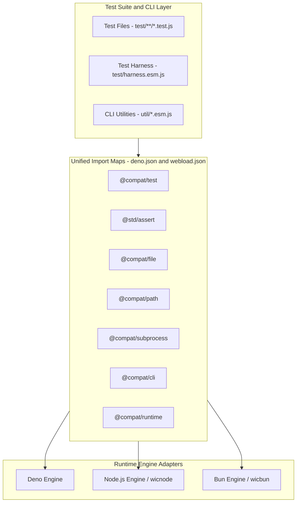

# Cross-Runtime Abstraction & Test Suite Migration Plan

This document establishes the architecture and phased migration plan for eliminating runtime-specific global and module dependencies across the codebase (specifically Deno-specific APIs and URL imports) in favor of cross-runtime abstractions. This modernization enables the test suite, CLI tooling, and library modules to run seamlessly across all major JavaScript runtimes (Deno, Node.js, and Bun / wicbun / wicnode) as well as web browsers using unified import maps and compatibility libraries.

---

## 1. Executive Summary & Goals

### Core Objectives
1. **Runtime Agnosticism**: Abstract away runtime globals (`Deno.*`, `process.*`, `Bun.*`) into portable compatibility libraries (`@compat/*` and `@std/assert`).
2. **Unified Module Import Maps**: Standardize [`deno.json`](deno.json) and introduce [`webload.json`](webload.json) to enable cross-engine resolution of standard assertions, test runners, file I/O, paths, and subprocesses.
3. **Test Suite Modernization**: Refactor test definitions from runtime-proprietary runners (`Deno.test` with `t.step`) to standard BDD syntax (`describe`, `it`, `beforeEach`, `afterEach` via [`@compat/test`](test/harness.esm.js:1)) across all 58+ test files.
4. **CLI & Utility Compatibility**: Upgrade CLI scripts in [`util/`](util/) and wrappers in [`bin/`](bin/) to consume cross-runtime filesystem, CLI parsing, and standard I/O abstractions.
5. **Cross-Engine Portability Documentation**: Author and update documentation (including project [`README.md`](README.md) and [`docs/Color-Tokens-CLI.md`](docs/Color-Tokens-CLI.md)) to guide developers on multi-runtime testing, import maps, and engine detection.

---

## 2. Architecture & Import Mapping Strategy

### 2.1 Cross-Runtime Abstraction Stack

The architecture replaces proprietary runtime built-ins with standard compatibility modules resolved via import maps:



### 2.2 Module Import Map Configuration

#### Updates to [`deno.json`](deno.json)
[`deno.json`](deno.json:1) will configure standard bare specifiers mapped to remote compatibility modules:

```json
{
	"nodeModulesDir": "none",
	"imports": {
		"escape-js/": "./resources/escape-js/",
		"@escape-js": "./resources/escape-js/src/escape.esm.js",
		"mesgjs/": "./resources/mesgjs/",
		"nanos/": "./resources/nanos/",
		"@nanos": "./resources/nanos/src/nanos.esm.js",
		"reactive/": "./resources/reactive/",
		"@reactive": "./resources/reactive/src/reactive.esm.js",
		"mesgjs-web/": "./",
		"@std/assert": "https://esm.sh/jsr/@std/assert?target=node",
		"@compat/test": "https://esm.sh/jsr/@tundralibs/compat@2.8.1/test?target=node",
		"@cross/test": "https://esm.sh/jsr/@cross/test?target=node",
		"@compat/file": "https://cdn.jsdelivr.net/gh/bkatzung/extcompat@0.6.0/src/file.esm.js",
		"@tundralibs/compat/file": "https://esm.sh/jsr/@tundralibs/compat@2.8.1/file?target=node",
		"@compat/path": "https://esm.sh/jsr/@tundralibs/compat@2.8.1/path?target=node",
		"@compat/runtime": "https://esm.sh/jsr/@tundralibs/compat@2.8.1/runtime?target=node",
		"@compat/stdin": "https://cdn.jsdelivr.net/gh/bkatzung/extcompat@0.6.0/src/stdin.esm.js",
		"@compat/subprocess": "https://cdn.jsdelivr.net/gh/bkatzung/extcompat@0.6.0/src/subprocess.esm.js",
		"@compat/cli": "https://esm.sh/jsr/@tundralibs/compat@2.8.1/cli?target=node"
	},
	"lint": {
		"rules": {
			"exclude": [ "no-unused-vars" ]
		}
	}
}
```

#### Creation of [`webload.json`](webload.json)
[`webload.json`](webload.json) will mirror the cross-runtime import map and establish security and script-source whitelisting for loaders such as `wicbun` and `wicnode`:

```json
{
	"imports": {
		"@escape-js": "https://cdn.jsdelivr.net/gh/mesgjs/escape-js@0.1.0/src/escape.esm.js",
		"mesgjs/": "./",
		"@nanos": "https://cdn.jsdelivr.net/gh/mesgjs/nanos@1.5.1/src/nanos.esm.js",
		"@reactive": "https://cdn.jsdelivr.net/gh/mesgjs/reactive@0.1.6/src/reactive.esm.js",
		"mesgjs-web/": "./",
		"@std/assert": "https://esm.sh/jsr/@std/assert?target=node",
		"@compat/test": "https://esm.sh/jsr/@tundralibs/compat@2.8.1/test?target=node",
		"@cross/test": "https://esm.sh/jsr/@cross/test?target=node",
		"@compat/file": "https://cdn.jsdelivr.net/gh/bkatzung/extcompat@0.6.0/src/file.esm.js",
		"@tundralibs/compat/file": "https://esm.sh/jsr/@tundralibs/compat@2.8.1/file?target=node",
		"@compat/path": "https://esm.sh/jsr/@tundralibs/compat@2.8.1/path?target=node",
		"@compat/runtime": "https://esm.sh/jsr/@tundralibs/compat@2.8.1/runtime?target=node",
		"@compat/stdin": "https://cdn.jsdelivr.net/gh/bkatzung/extcompat@0.6.0/src/stdin.esm.js",
		"@compat/subprocess": "https://cdn.jsdelivr.net/gh/bkatzung/extcompat@0.6.0/src/subprocess.esm.js",
		"@compat/cli": "https://esm.sh/jsr/@tundralibs/compat@2.8.1/cli?target=node"
	},
	"script-src": [
		"https://cdn.jsdelivr.net/gh/bkatzung/",
		"https://cdn.jsdelivr.net/gh/mesgjs/",
		"https://esm.sh/"
	]
}
```

---

## 3. Migration Patterns & Code Examples

### 3.1 Assertion Imports

**Current Legacy Pattern:**
```javascript
import {
	assert,
	assertEquals,
	assertStrictEquals,
	assertNotStrictEquals,
	assertMatch,
	assertRejects,
	assertExists,
} from "https://deno.land/std@0.152.0/testing/asserts.ts";
```

**Cross-Runtime Pattern:**
```javascript
import {
	assert,
	assertEquals,
	assertStrictEquals,
	assertNotStrictEquals,
	assertMatch,
	assertRejects,
	assertExists,
} from '@std/assert';
```

---

### 3.2 Test Definitions (`Deno.test` / `t.step` to BDD `describe` / `it`)

**Current Legacy Pattern:**
```javascript
Deno.test("MWIDocNode - Attribute Operations", async (t) => {
	await t.step("(setAttr) - Set string attribute", () => {
		const div = doc.createNode('h.div');
		div.setAttr('title', 'sample');
		assertEquals(div.getAttr('title'), 'sample');
	});

	await t.step("(getAttr) - Non-existent attribute", () => {
		const div = doc.createNode('h.div');
		assertStrictEquals(div.getAttr('unknown'), undefined);
	});
});
```

**Cross-Runtime Pattern:**
```javascript
import { describe, it } from '@compat/test';
import { assertEquals, assertStrictEquals } from '@std/assert';

describe("MWIDocNode - Attribute Operations", () => {
	it("(setAttr) - Set string attribute", () => {
		const div = doc.createNode('h.div');
		div.setAttr('title', 'sample');
		assertEquals(div.getAttr('title'), 'sample');
	});

	it("(getAttr) - Non-existent attribute", () => {
		const div = doc.createNode('h.div');
		assertStrictEquals(div.getAttr('unknown'), undefined);
	});
});
```

---

### 3.3 Test Harness File I/O ([`test/harness.esm.js`](test/harness.esm.js))

**Current Legacy Pattern:**
```javascript
export async function loadMesgjsModulePath (path, module = path) {
	const source = await Deno.readTextFile(path);
	return loadMesgjsModuleSource(source, module);
}
```

**Cross-Runtime Pattern:**
```javascript
import { readTextFile } from '@compat/file';

export async function loadMesgjsModulePath (path, module = path) {
	const source = await readTextFile(path);
	return loadMesgjsModuleSource(source, module);
}
```

---

### 3.4 Subprocess Spawning ([`test/color-token-cli.test.js`](test/color-token-cli.test.js))

**Current Legacy Pattern:**
```javascript
async function runCli (args = [], options = {}) {
	const cmd = [Deno.execPath(), "run", "--allow-read", CLI_PATH, ...args];
	const p = Deno.run({
		cmd,
		stdout: "piped",
		stderr: "piped",
		stdin: options.stdin ? "piped" : "null",
		cwd: options.cwd || undefined,
	});
	// ... stream piping and p.status/output/close
}
```

**Cross-Runtime Pattern:**
```javascript
import { spawn } from '@compat/subprocess';
import * as path from '@compat/path';
import { fromFileUrl } from '@compat/file';

const __filename = fromFileUrl(import.meta.url);
const __dirname = path.dirname(__filename);
const CLI_PATH = path.resolve(__dirname, '../bin/mwi-color-tokens');

async function runCli (args = [], options = {}) {
	try {
		const proc = spawn(CLI_PATH, args, {
			cwd: options.cwd || undefined,
			stdin: options.stdin ? options.stdin : undefined,
		});
		const res = await proc.text();
		return {
			code: res.code,
			success: res.code === 0,
			stdout: res.stdout,
			stderr: res.stderr,
		};
	} catch (err) {
		return {
			code: err.code ?? 1,
			success: false,
			stdout: err.stdout ?? '',
			stderr: err.stderr ?? err.message,
		};
	}
}
```

---

### 3.5 CLI Tools & Script Migration ([`util/*.esm.js`](util/))

**Current Legacy Pattern ([`util/md-to-mwi-cli.esm.js`](util/md-to-mwi-cli.esm.js)):**
```javascript
function main () {
	if (Deno.args.length === 0) {
		console.error('Error: No input file specified');
		Deno.exit(1);
	}
	const inputFile = Deno.args[0];
	const markdownContent = Deno.readTextFileSync(inputFile);
	// ...
}
```

**Cross-Runtime Pattern:**
```javascript
import { readTextFileSync } from '@compat/file';
import { args, exit } from '@compat/cli';

function main () {
	if (args.length === 0) {
		console.error('Error: No input file specified');
		exit(1);
	}
	const inputFile = args[0];
	const markdownContent = readTextFileSync(inputFile);
	// ...
}
```

---

## 4. Documentation Strategy & Cross-Engine Portability Guide

As part of the migration, documentation will be established and updated to describe cross-runtime capabilities, module loading mechanics, and multi-engine CLI/test invocation:

### 4.1 Project [`README.md`](README.md)
Create a project [`README.md`](README.md) containing a dedicated **Cross-Engine Portability** section:
- **Standards-Compliant ESM**: Highlight that MWI and its CLI utilities are pure ESM modules that execute directly across **Deno**, **Bun**, **Node.js**, and modern **Web Browsers**.
- **Module Resolution & Caching with `@bkatzung/webload`**:
  - **Browsers**: Native `<script type="module">` and browser import maps.
  - **Deno**: Native import map support (`deno test --config deno.json` or `webload.json`).
  - **Node.js**: Execution via `wicnode` (or `node --import @bkatzung/webload/node`) with local dependency disk caching.
  - **Bun**: Execution via `wicbun` (or `bun --preload @bkatzung/webload/bun`).
- **Engine Auto-Probing**: Document how CLI wrappers in [`bin/`](bin/) probe available runtimes (`deno` -> `wicbun` -> `wicnode`) and honor the `MESGJS_ENGINE` environment variable (`MESGJS_ENGINE=deno`, `MESGJS_ENGINE=bun`, `MESGJS_ENGINE=node`).

### 4.2 CLI & Tool Guides ([`docs/Color-Tokens-CLI.md`](docs/Color-Tokens-CLI.md))
Update CLI references to present multi-engine syntax alongside shell wrapper invocations:
```bash
# Using shell wrapper (auto-probes engine)
bin/mwi-color-tokens [options] [config-file.json]

# Or via explicit runtimes
deno run --allow-read util/color-token-cli.esm.js [options]
wicbun ./util/color-token-cli.esm.js [options]
wicnode ./util/color-token-cli.esm.js [options]
```

---

## 5. Affected File Inventory & Classification

### 5.1 Configuration & Harness (Phase 1)
| File | Changes Required |
|---|---|
| [`deno.json`](deno.json) | Add bare specifier mapping entries for `@std/assert`, `@compat/*`, `@cross/test`. |
| [`webload.json`](webload.json) | Create cross-runtime loader config with identical imports and `script-src` whitelist. |
| [`test/harness.esm.js`](test/harness.esm.js) | Replace `Deno.readTextFile` with `readTextFile` from `@compat/file`. |
| [`test/repl-init.esm.js`](test/repl-init.esm.js) | Ensure import map compatibility. |
| [`test/template.js`](test/template.js) | Update assertion imports and migrate `Deno.test` to `describe` / `it`. |

---

### 5.2 Core Tests (`test/core/` - 15 Files) (Phase 2)
Convert `https://deno.land/std@0.152.0/testing/asserts.ts` imports to `@std/assert` and migrate `Deno.test` / `t.step` to `describe` / `it` from `@compat/test`:
- [`test/core/aggr.test.js`](test/core/aggr.test.js)
- [`test/core/comment.test.js`](test/core/comment.test.js)
- [`test/core/defer.test.js`](test/core/defer.test.js)
- [`test/core/doc-node.test.js`](test/core/doc-node.test.js)
- [`test/core/document.test.js`](test/core/document.test.js)
- [`test/core/form.test.js`](test/core/form.test.js)
- [`test/core/fragment.test.js`](test/core/fragment.test.js)
- [`test/core/node-parent.test.js`](test/core/node-parent.test.js)
- [`test/core/registry-deferred.test.js`](test/core/registry-deferred.test.js)
- [`test/core/registry.test.js`](test/core/registry.test.js)
- [`test/core/scoped-css.test.js`](test/core/scoped-css.test.js)
- [`test/core/slot.test.js`](test/core/slot.test.js)
- [`test/core/slotting-source.test.js`](test/core/slotting-source.test.js)
- [`test/core/source.test.js`](test/core/source.test.js)
- [`test/core/template.test.js`](test/core/template.test.js)
- [`test/core/text.test.js`](test/core/text.test.js)

---

### 5.3 SSR HTML Tests (`test/ssr-html/` - 18 Files) (Phase 3)
Convert assertions and migrate `Deno.test` / `t.step` to `describe` / `it`:
- [`test/ssr-html/aggr-comp.test.js`](test/ssr-html/aggr-comp.test.js)
- [`test/ssr-html/aggr-script.test.js`](test/ssr-html/aggr-script.test.js)
- [`test/ssr-html/aggr.test.js`](test/ssr-html/aggr.test.js)
- [`test/ssr-html/comment.test.js`](test/ssr-html/comment.test.js)
- [`test/ssr-html/compound-scoped.test.js`](test/ssr-html/compound-scoped.test.js)
- [`test/ssr-html/compound.test.js`](test/ssr-html/compound.test.js)
- [`test/ssr-html/defer.test.js`](test/ssr-html/defer.test.js)
- [`test/ssr-html/doc-node.test.js`](test/ssr-html/doc-node.test.js)
- [`test/ssr-html/document.test.js`](test/ssr-html/document.test.js)
- [`test/ssr-html/form.test.js`](test/ssr-html/form.test.js)
- [`test/ssr-html/fragment.test.js`](test/ssr-html/fragment.test.js)
- [`test/ssr-html/html.test.js`](test/ssr-html/html.test.js)
- [`test/ssr-html/m-rns.test.js`](test/ssr-html/m-rns.test.js)
- [`test/ssr-html/mcoat.test.js`](test/ssr-html/mcoat.test.js)
- [`test/ssr-html/scoped-css.test.js`](test/ssr-html/scoped-css.test.js)
- [`test/ssr-html/slot.test.js`](test/ssr-html/slot.test.js)
- [`test/ssr-html/source.test.js`](test/ssr-html/source.test.js)
- [`test/ssr-html/split-regions.test.js`](test/ssr-html/split-regions.test.js)
- [`test/ssr-html/style-aggr.test.js`](test/ssr-html/style-aggr.test.js)
- [`test/ssr-html/template.test.js`](test/ssr-html/template.test.js)
- [`test/ssr-html/text.test.js`](test/ssr-html/text.test.js)

---

### 5.4 CSR DOM & Hydration Tests (`test/csr-dom/` & `test/ssr-csr-hyd/` - 24 Files) (Phase 4)
Convert assertions, migrate `Deno.test` / `t.step` to `describe` / `it`, and ensure browser simulation (`simulateBrowser`) is clean across engines:
- `test/csr-dom/*.test.js` (16 files)
- `test/ssr-csr-hyd/*.test.js` (6 files)

---

### 5.5 CLI Tools, Theme Tests, Bin Wrappers & Docs (Phase 5)
| File | Action |
|---|---|
| [`test/color-token-tool.test.js`](test/color-token-tool.test.js) | Migrate assertions and `Deno.test` blocks to `@compat/test`. |
| [`test/color-token-cli.test.js`](test/color-token-cli.test.js) | Replace `Deno.run` with `@compat/subprocess` (`spawn`) and `@compat/file` path utilities. |
| [`util/color-token-cli.esm.js`](util/color-token-cli.esm.js) | Replace `Deno.args`, `Deno.stdin`, `Deno.readTextFileSync`, `Deno.isatty`, `Deno.exit` with `@compat/cli` and `@compat/file`. |
| [`util/md-to-mwi-cli.esm.js`](util/md-to-mwi-cli.esm.js) | Replace `Deno.args`, `Deno.readTextFileSync`, `Deno.exit` with `@compat/cli` and `@compat/file`. |
| [`util/mwi-to-html-cli.esm.js`](util/mwi-to-html-cli.esm.js) | Replace `Deno.args`, `Deno.stdin`, `Deno.readTextFile`, `Deno.exit` with `@compat/cli` and `@compat/file`. |
| [`util/mwi-to-html-cli-in.esm.js`](util/mwi-to-html-cli-in.esm.js) | Replace `Deno.args`, `Deno.stdin`, `Deno.readTextFile`, `Deno.exit` with `@compat/cli` and `@compat/file`. |
| [`README.md`](README.md) | Create root documentation covering cross-engine portability, webload caching, and testing. |
| [`docs/Color-Tokens-CLI.md`](docs/Color-Tokens-CLI.md) | Update CLI reference to document cross-runtime execution patterns. |
| [`Makefile`](Makefile) | Update test targets if necessary to support multi-runtime test runners. |

---

## 6. Step-by-Step Implementation Roadmap

```mermaid
gantt
    title Migration Roadmap
    dateFormat  X
    axisFormat %s
    section Phase 1: Foundation
    Configure deno.json and webload.json       :p1_1, 0, 1
    Update test/harness.esm.js and template.js  :p1_2, 1, 2
    section Phase 2: Core Tests
    Migrate test/core/*.test.js                 :done, p2_1, 2, 3
    section Phase 3: SSR HTML Tests
    Migrate test/ssr-html/*.test.js             :p3_1, 3, 4
    section Phase 4: CSR DOM & Hydration Tests
    Migrate test/csr-dom/*.test.js              :p4_1, 4, 5
    Migrate test/ssr-csr-hyd/*.test.js          :p4_2, 5, 6
    section Phase 5: CLI, Theme, Bin & Docs
    Migrate Theme & CLI Tests                   :p5_1, 6, 7
    Migrate util/*.esm.js CLI Scripts           :p5_2, 7, 8
    Author README.md and update CLI docs        :p5_3, 8, 9
    section Phase 6: Multi-Runtime Validation
    Validate across Deno, Node, and Bun         :p6_1, 9, 10
```



### Phase 1: Foundation & Import Maps
1. Update [`deno.json`](deno.json) with `@compat/*`, `@std/assert`, and `@cross/test` mappings.
2. Create [`webload.json`](webload.json) with corresponding mappings and `script-src` policies.
3. Update [`test/harness.esm.js`](test/harness.esm.js) to consume `readTextFile` from `@compat/file`.
4. Validate baseline imports with a pilot test file ([`test/template.js`](test/template.js)).

### Phase 2: Core Test Suite Migration (COMPLETED)
1. Batch-migrate all test files under [`test/core/`](test/core/).
2. Replace assertion imports with `@std/assert`.
3. Transform `Deno.test("...", async (t) => { await t.step("...", () => {}) })` blocks into `describe("...", () => { it("...", () => {}) })`.
4. Verified all `test/core/` test files run cleanly under `@compat/test` and `@std/assert`.

### Phase 3: SSR HTML Test Suite Migration (COMPLETED)
1. Batch-migrated all 21 test files under [`test/ssr-html/`](test/ssr-html/).
2. Updated assertion imports to `@std/assert` and migrated to `describe`/`it` structure from `@compat/test`.
3. Verified all `test/ssr-html/` tests run and pass cleanly (98 passed, 507 steps).

### Phase 4: CSR DOM & Hydration Test Suite Migration (COMPLETED)
1. **[x] Step 1: Migrate all 19 test files under [`test/csr-dom/`](test/csr-dom/)**:
   - Converted all assertion imports to `@std/assert`.
   - Converted all test definitions from `Deno.test` / `t.step` to BDD `describe` / `it` from `@compat/test`.
   - Verified 100% test pass across entire CSR DOM suite (`103 passed (456 steps) | 0 failed`).
2. **[x] Step 2: Migrate all 6 test files under [`test/ssr-csr-hyd/`](test/ssr-csr-hyd/)**:
   - [`test/ssr-csr-hyd/aggr-script.test.js`](test/ssr-csr-hyd/aggr-script.test.js)
   - [`test/ssr-csr-hyd/aggr-sync.test.js`](test/ssr-csr-hyd/aggr-sync.test.js)
   - [`test/ssr-csr-hyd/basic-sync.test.js`](test/ssr-csr-hyd/basic-sync.test.js)
   - [`test/ssr-csr-hyd/special-core-sync.test.js`](test/ssr-csr-hyd/special-core-sync.test.js)
   - [`test/ssr-csr-hyd/special-html-sync.test.js`](test/ssr-csr-hyd/special-html-sync.test.js)
   - [`test/ssr-csr-hyd/style-aggr-sync.test.js`](test/ssr-csr-hyd/style-aggr-sync.test.js)
3. **[x] Step 3: Verify `simulateBrowser()` lifecycle with `@compat/test` test runner**.
4. **[x] Step 4: Run full test suite to verify 100% test pass across all suites (`341 passed (1808 steps) | 0 failed`)**.

### Phase 5: CLI Tools, Theme Tests, Bin Wrappers & Documentation (COMPLETED)
1. **[x] Step 1: Update [`test/color-token-tool.test.js`](test/color-token-tool.test.js) and [`test/color-token-cli.test.js`](test/color-token-cli.test.js)**:
   - Converted assertion imports to `@std/assert` and migrated tests to BDD `describe` / `it`.
   - Updated CLI test runner in [`test/color-token-cli.test.js`](test/color-token-cli.test.js) to utilize `@compat/subprocess` (`spawn`) and cross-runtime file/path helpers.
2. **[x] Step 2: Refactor CLI utilities in [`util/`](util/) and wrappers in [`bin/`](bin/)**:
   - Upgraded [`util/color-token-cli.esm.js`](util/color-token-cli.esm.js), [`util/md-to-mwi-cli.esm.js`](util/md-to-mwi-cli.esm.js), [`util/mwi-to-html-cli.esm.js`](util/mwi-to-html-cli.esm.js), and [`util/mwi-to-html-cli-in.esm.js`](util/mwi-to-html-cli-in.esm.js) to consume `@compat/cli` (`args`, `isTTY`), `@compat/runtime` (`exit`), `@compat/file` (`readTextFile`, `readTextFileSync`), and `@compat/stdin` (`readStdinText`, `readStdinTextSync`).
   - Implemented runtime probe ladder (`deno` -> `wicbun` -> `wicnode`) and `MESGJS_ENGINE` environment variable support across all [`bin/*`](bin/) wrappers (`bin/mwi-color-tokens`, `bin/md-to-mwi`, `bin/mwi-to-html`).
3. **[x] Step 3: Author root [`README.md`](README.md)**:
   - Documented project architecture, bilingual interface design, cross-runtime execution with `@bkatzung/webload`, engine probing, CLI tools, and test runner usage.
4. **[x] Step 4: Update [`docs/Color-Tokens-CLI.md`](docs/Color-Tokens-CLI.md)**:
   - Added multi-runtime command execution examples (`MESGJS_ENGINE`, `deno`, `wicbun`, `wicnode`).
5. **[x] Step 5: Verify CLI execution and test suite**:
   - Verified CLI direct execution and stdin piping.
   - Verified 100% test pass across all 340 test suites and 1,803 test steps (`make test-all`).

### Phase 6: Cross-Engine Validation & Verification (COMPLETED)
1. **[x] Step 1: Run entire test suite under Deno (`make test-all`)**:
   - `340 passed (1803 steps) | 0 failed`.
2. **[x] Step 2: Execute entire test suite under Node.js / `wicnode`**:
   - `341 suites | 1808 tests | 1808 passed | 0 failed`.
3. **[x] Step 3: Execute entire test suite under Bun / `wicbun`**:
   - `1808 pass | 0 fail`.
4. **[x] Step 4: Ensure zero remaining runtime lock-in**:
   - Confirmed 0 references to `https://deno.land/std`, proprietary `Deno.*` calls, or unabstracted runtime globals across the codebase.
