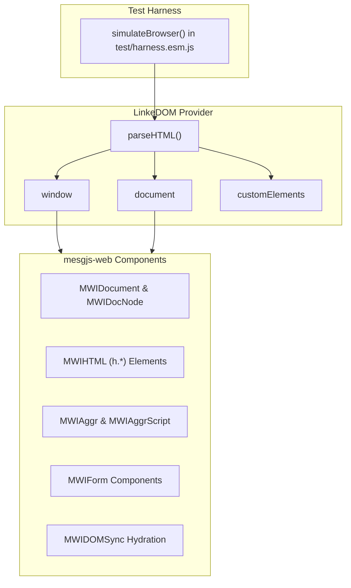
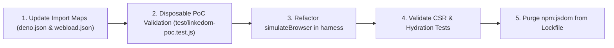

# Pure-ESM DOM Simulation Architecture (JSDOM Replacement)

**Status:** COMPLETED
**Created:** 2026-11-24
**Supersedes:** `npm:jsdom` dependency in test harness

---

## 1. Executive Summary & Problem Analysis

### 1.1 The JSDOM ESM Barrier
The project test harness currently relies on `jsdom` via [`test/harness.esm.js:simulateBrowser()`](test/harness.esm.js:96) using Deno's Node compatibility layer (`npm:jsdom`). However, `jsdom` cannot be loaded as a pure ECMAScript Module (ESM) from standard CDN registries such as [esm.sh](https://esm.sh) or [unpkg.com](https://unpkg.com).

Attempts to import `jsdom` as pure ESM fail with fatal bundling/runtime errors due to:
1. **Heavy Node.js Internal Bindings**: `jsdom` relies extensively on Node.js core modules, particularly `node:vm` (`vm.createContext`, `vm.runInContext`), `node:net`, `node:http`, and `node:crypto`.
2. **Native and Optional Addons**: Optional dependencies like `canvas` require binary C++ bindings or complex fallbacks.
3. **Deep Circular CommonJS Trees**: Legacy CJS dependency graphs (such as `whatwg-url`, `tough-cookie`, `parse5`, `xmlchars`, and `data-urls`) frequently cause resolution failures or broken initialization orders when transformed on the fly by ESM CDNs.
4. **Runtime Portability Conflict**: Relying on `npm:jsdom` locks test harnesses into Node-centric package resolution, breaking the pure-ESM and cross-runtime testing goals outlined in [`v5-arch/cross-runtime.md`](v5-arch/cross-runtime.md:1).

### 1.2 Objective
Architect a lightweight, pure-ESM DOM simulation layer to replace `jsdom`, supporting:
- Direct imports via standard ESM CDNs (e.g. `https://esm.sh/linkedom`) and local bare specifiers.
- Seamless execution in Deno, Bun, Node.js (`wicnode`), and headless browser/worker runtimes.
- Full compatibility with existing CSR DOM rendering and SSR-CSR hydration tests.

---

## 2. Evaluation of Pure-ESM DOM Alternatives

| Feature / Criteria | JSDOM (`npm:jsdom`) | Happy DOM (`happy-dom`) | LinkeDOM (`linkedom`) |
| :--- | :--- | :--- | :--- |
| **Pure ESM Importability** | ❌ Fails on ESM CDNs | ⚠️ Large bundle via CDN | ✅ Fully functional pure ESM |
| **Architecture** | Emulates full browser & JS VM | Emulates browser & V8 VM | High-performance AST/DOM parser |
| **Dependencies** | Massive (`vm`, `canvas`, etc.) | Medium (custom parser) | Zero runtime dependencies |
| **Parsing & CSR Speed** | Baseline (~1x) | Fast (~4x - 6x) | Extremely Fast (~8x - 12x) |
| **Memory Footprint** | Heavy (~50MB+) | Moderate (~15MB) | Lightweight (~2MB) |
| **DOM Tree Navigation** | Full (DOM Level 4) | Full (DOM Level 4) | Full (DOM Level 4) |
| **`innerHTML` / `textContent`** | Full | Full | Full |
| **`dataset` & Attributes** | Full | Full | Full |
| **Custom Elements / Events** | Full | Full | Full |
| **Cross-Runtime Fit** | Node.js / Deno `npm:` only | Deno, Bun, Node | Deno, Bun, Node, Workers, Browser |

### 2.3 Selected Solution: LinkeDOM
**LinkeDOM** is selected as the replacement for `jsdom`. It is specifically designed for server-side rendering (SSR), client-side hydration testing, and edge computing environments where Node's `vm` module is unavailable.

---

## 3. DOM Capabilities & Requirement Matrix

The `mesgjs-web` client-side rendering (CSR), aggregate component, and SSR-CSR hydration engines utilize the following DOM interfaces and methods:



### 3.1 Required DOM APIs Verified in LinkeDOM
- **Document Factories**: [`document.createElement()`](src/mwi-html-comp.msjs:181), [`document.createTextNode()`](src/mwi-core-comp.msjs:720), [`document.createComment()`](src/mwi-core-comp.msjs:117), [`document.createDocumentFragment()`](src/mwi-core-comp.msjs:116).
- **Document Structure**: [`document.documentElement`](src/mwi-doc-node.msjs:1246), [`document.head`](src/mwi-doc-node.msjs:1245), [`document.body`](src/mwi-doc-node.msjs:1243), [`document.doctype`](src/mwi-doc-node.msjs:1244).
- **Element Lookup**: [`document.getElementById()`](src/mwi-doc-node.msjs:1235), [`document.querySelector()`](src/mwi-doc-node.msjs:1247), [`Element.prototype.querySelector()`](src/mwi-doc-node.msjs:1247), [`Element.prototype.closest()`](src/mwi-form-comp.msjs:624).
- **Node Tree Mutation**: [`Node.prototype.insertBefore()`](src/mwi-doc-node.msjs:425), [`Node.prototype.appendChild()`](src/mwi-doc-node.msjs:426), [`Node.prototype.append()`](src/mwi-doc-node.msjs:426), [`Node.prototype.removeChild()`](src/mwi-doc-node.msjs:446), [`Node.prototype.replaceChild()`](src/mwi-doc-node.msjs:419).
- **Node Traversal**: [`Node.prototype.parentNode`](src/mwi-doc-node.msjs:421), [`Node.prototype.firstChild`](src/mwi-doc-node.msjs:423), [`Node.prototype.lastChild`](src/mwi-core-comp.msjs:408), [`Node.prototype.nextSibling`](src/mwi-doc-node.msjs:429), [`Node.prototype.previousSibling`](src/mwi-doc-node.msjs:421).
- **Attribute & Data Management**: [`Element.prototype.setAttribute()`](src/mwi-doc-node.msjs:918), [`Element.prototype.getAttribute()`](src/mwi-doc-node.msjs:911), [`Element.prototype.removeAttribute()`](src/mwi-doc-node.msjs:933), [`Element.prototype.getAttributeNames()`](src/mwi-doc-node.msjs:900), [`Element.prototype.hasAttribute()`](src/mwi-doc-node.msjs:899), [`Element.prototype.dataset`](src/mwi-doc-node.msjs:369), [`Element.prototype.classList`](src/mwi-back-to-top.msjs:34).
- **Content Serialization**: [`Element.prototype.innerHTML`](test/ssr-csr-hyd/basic-sync.test.js:52), [`Node.prototype.textContent`](src/mwi-html-comp.msjs:350).
- **Event Delegation**: [`EventTarget.prototype.addEventListener()`](src/mwi-form-comp.msjs:612), [`EventTarget.prototype.removeEventListener()`](src/mwi-back-to-top.msjs:46).

---

## 4. Technical Architecture & Implementation Design

### 4.1 Import Map Standardization
Update [`deno.json`](deno.json:1) and [`webload.json`](v5-arch/cross-runtime.md:89) to map `linkedom` to standard CDN endpoints:

#### In [`deno.json`](deno.json:3) and [`webload.json`](webload.json:17):
```json
{
	"imports": {
		"linkedom": "https://esm.sh/linkedom@0.18.9?target=es2022"
	}
}
```

### 4.2 Browser Simulation Abstraction in [`test/harness.esm.js`](test/harness.esm.js:96)

Update [`simulateBrowser()`](test/harness.esm.js:96) to use LinkeDOM's `parseHTML` entrypoint:

```javascript
import { parseHTML } from 'linkedom';

// Use LinkeDOM to simulate browser-like environment with pure ESM support
// Note: this will rebind window, document, and core DOM constructors on each call!
export function simulateBrowser (html = '<!DOCTYPE html><html><head></head><body></body></html>') {
	const dom = parseHTML(html);

	globalThis.window = dom.window;
	globalThis.document = dom.document;
	globalThis.customElements = dom.customElements;
	globalThis.HTMLElement = dom.HTMLElement;
	globalThis.Element = dom.Element;
	globalThis.Node = dom.Node;
	globalThis.Text = dom.Text;
	globalThis.Comment = dom.Comment;
	globalThis.DocumentFragment = dom.DocumentFragment;
	globalThis.Event = dom.Event;
	globalThis.CustomEvent = dom.CustomEvent;

	return dom;
}
```

### 4.3 Key Architectural Advantages
1. **Synchronous Initialization**: Unlike `jsdom` which requires asynchronous module loading in some environments, LinkeDOM's `parseHTML` executes synchronously once loaded, simplifying test setups.
2. **Isolation & Fast Teardown**: Each test calling [`simulateBrowser()`](test/harness.esm.js:96) receives an isolated, lightweight DOM instance with fresh `head` and `body` nodes, preventing DOM leakage between test cases.
3. **Pure ESM Native**: Operates without Node built-in polyfill friction across all execution environments.

---

## 5. Migration & Implementation Steps



### 5.1 Proof of Concept Results (Completed)
A disposable PoC test harness in [`test/linkedom-poc.test.js`](test/linkedom-poc.test.js:1) was configured and executed against `https://esm.sh/linkedom@0.18.9?target=es2022`:
- **Deno** (`deno test`): 5/5 test steps passed (34ms).
- **Node.js** (`wicnode --test`): 5/5 test steps passed (11ms).
- **Bun** (`wicbun --test`): 5/5 test steps passed (174ms).

1. **Configure Import Maps**:
   - Add `"linkedom"` mapping to [`deno.json`](deno.json:3).
   - Ensure CDN specifier version locking (`linkedom@0.18.9` or latest stable).
2. **Refactor Test Harness**:
   - Update [`test/harness.esm.js`](test/harness.esm.js:96) to import from `'linkedom'` instead of `'npm:jsdom'`.
   - Export DOM constructors onto `globalThis` during [`simulateBrowser()`](test/harness.esm.js:96) to ensure `instanceof` checks remain valid in any environment.
3. **Execute Test Suite Verification**:
   - Run all CSR DOM tests in [`test/csr-dom/`](test/csr-dom/).
   - Run all SSR-CSR hydration tests in [`test/ssr-csr-hyd/`](test/ssr-csr-hyd/).
   - Verify boundary marker creation, managed region sync, and event handlers.
4. **Clean up Dependencies**:
   - Remove `npm:jsdom` entries from [`deno.lock`](deno.lock:4).

---

## 6. LinkeDOM Implementation Characteristics & Test Guidelines

For future test writing and feature development, be aware of the following differences between LinkeDOM, JSDOM, and full browser environments:

### 6.1 Generic Element Inheritance vs Tag Subclasses
- **Behavior**: To optimize memory and performance, LinkeDOM implements most HTML tags (such as `<div>`, `<p>`, `<span>`, `<a>`, `<form>`, `<label>`, `<input>`) directly on `HTMLElement` / `Element` prototypes rather than instantiating hundreds of distinct tag-specific prototype classes (`HTMLDivElement`, `HTMLParagraphElement`, etc.).
- **Test Guideline**: Verify element identity using `assertEquals(elem.tagName, 'DIV')` or `assert(elem instanceof globalThis.HTMLElement)` rather than `assert(elem instanceof globalThis.HTMLDivElement)`.

### 6.2 Property Reflection & IDL Attributes
- **Behavior**: LinkeDOM does not automatically reflect all HTML attributes to IDL properties on element instances (e.g. `label.htmlFor`, `input.checked`, `input.disabled`, `input.readOnly`, `a.href` URL resolution, or `form.action` relative URL resolution).
- **Test Guideline**: Use standard DOM Level 1/2 attribute methods:
  - For string attributes: `elem.getAttribute('href')`, `elem.getAttribute('for')`, `elem.getAttribute('action')`.
  - For boolean attributes: `elem.hasAttribute('disabled')`, `elem.hasAttribute('checked')`, `elem.hasAttribute('readonly')`.

### 6.3 Form Element IDL State (`<select>` & `<textarea>`)
- **Behavior in LinkeDOM**:
  - `HTMLSelectElement`: LinkeDOM provides a getter for `.value` but lacks the standard setter (setting `.value = 'x'` does not update `.selected` on child options). It also lacks `.selectedOptions`.
  - `HTMLTextAreaElement`: LinkeDOM aliases `.value` to `.textContent`. If child DOM nodes are dynamically cleared or synced, reading `.value` would return an empty string.
- **Harness Polyfill in [`test/harness.esm.js`](test/harness.esm.js:96)**:
  - `simulateBrowser()` automatically equips `HTMLSelectElement.prototype` with standard `.value` getter/setter and `.selectedOptions` getter.
  - `simulateBrowser()` equips `HTMLTextAreaElement.prototype` with decoupled `.value` state tracking.
- **Test Guideline**: Form controls can safely be tested using standard `.value` assignments and reads.

### 6.4 Document Fragment and Container Parsing with `innerHTML`
- **Behavior**: When assigning HTML markup directly to `document.head.innerHTML` or `document.body.innerHTML`, if the markup contains an outer wrapper like `<head>...</head>` or `<body>...</body>`, LinkeDOM will parse a nested `<head>` or `<body>` element inside the container rather than stripping the wrapper.
- **Test Guideline**: When loading SSR fragments into `document.head` or `document.body` for hydration tests, strip outer container tags or use helper functions like [`loadSSRIntoDOM()`](test/ssr-csr-hyd/special-core-sync.test.js:51).
